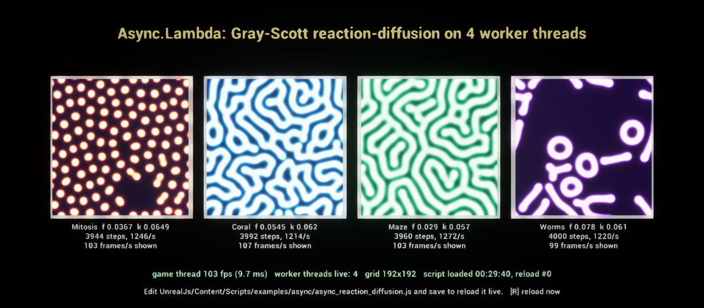

# Unreal.js Plugin - getnamo fork

Some opinionated changes to add certain features for live gameplay coding. Not all upstream functionality is guaranteed, but best effort is used when upgrading engine versions.

See upstream for wiki/instructions, API is largely the same: https://github.com/ncsoft/Unreal.js

## V8 version

This fork targets **UE 5.8** and embeds **V8 14.6.202** (built from the `branch-heads/14.6`
stable line; upgraded in 2.0.0 from the long-standing V8 7.4.288). V8 is linked as a single
monolithic static library per platform:

| Platform | Lib | Status |
|---|---|---|
| Win64 | `ThirdParty/v8/lib/Win64/Release/v8_monolith.lib` | validated |
| Android arm64-v8a (phones, Meta Quest) | `ThirdParty/v8/lib/Android/arm64-v8a/libv8_monolith.a` | validated |
| Android x86_64 (emulator) | `ThirdParty/v8/lib/Android/x86_64/libv8_monolith.a` | validated |
| Linux x86_64 | `ThirdParty/v8/lib/Linux/x86_64/libv8_monolith.a` | validated |

## Build & setup

The prebuilt V8 monolith + headers ship under `ThirdParty/v8/` (libs via the `v8-*-libs.7z`
release archive / `install-v8-libs`), so for normal use you only need to enable the plugin and
build your project as usual (UE 5.8).

### Android notes

- armv7 is not supported (UE 5.8 only builds arm64 and x86_64 for Android).
- With the Launcher (installed) engine, keep your project's **NDK API Level** at the engine's
  `android-26` (Project Settings → Android SDK, or `NDKAPILevelOverride=android-26` in
  `DefaultEngine.ini`). Compiling project/plugin code for API 29+ against the engine's prebuilt
  API-26 binaries mixes native and emulated TLS and fails to link with
  `undefined symbol: LowLevelTasks::FTask::ActiveTask`.

### Rebuilding V8 from source (only needed to bump the V8 version / add a platform)

V8 has no prebuilt UE-compatible distribution, so it is built from source. The scripts in
`ThirdParty/v8/build/` automate all of this (`Build-V8-Win64.ps1`, plus `Build-V8-Android.sh` and
`Build-V8-Linux.sh` from a Linux/WSL2 host); see its README. The manual Win64 recipe:

1. Use an up-to-date **depot_tools** (the copy bundled with the UE toolchain is too old to
   parse modern V8 `DEPS`). `fetch v8`, then `git checkout branch-heads/14.6` and `gclient sync`.
2. The V8 build must be configured to match the engine ABI. Apply these **gn args**
   (`out/<cfg>/args.gn`): `v8_monolithic=true`, `is_component_build=false`,
   `v8_use_external_startup_data=false`, `use_custom_libcxx=false`,
   `v8_enable_pointer_compression=true`, `v8_enable_sandbox=false`,
   `v8_enable_i18n_support=false`, `use_allocator_shim=false`,
   `v8_enable_temporal_support=false`.
3. Apply these **V8 source patches** (required for a UE-linkable Windows build; re-apply after
   any `gclient sync`):
   - `build/toolchain/win/setup_toolchain.py` — pin the MSVC toolset via `-vcvars_ver` (V8 14.6
     needs MSVC 14.40+; the default may be older and fails to compile).
   - `src/base/functional/bind-internal.h` — add `#include <functional>` and a `std::function`
     specialization of `ExtractCallableRunTypeImpl` (MSVC STL compatibility).
   - `build/config/compiler/BUILD.gn` — `config("no_exceptions")` on Windows must use
     `_HAS_EXCEPTIONS=1` + `/EHsc` to match UE (otherwise `std::_Raise_handler` link errors).
   - `build/config/win/BUILD.gn` — `default_crt` desktop branch must select `dynamic_crt` (`/MD`,
     matching UE) instead of `static_crt`.
4. `ninja -C out/<cfg> v8_monolith`, then copy `obj/v8_monolith.lib` to
   `ThirdParty/v8/lib/<Platform>/Release/` and refresh `ThirdParty/v8/include/` from the checkout.

`Source/V8/V8.Build.cs` links the monolith (plus `winmm/dbghelp/shlwapi/bcrypt` on Win64, `log` on
Android; nothing extra on Linux), and on every platform defines
`V8_COMPRESS_POINTERS`, `V8_31BIT_SMIS_ON_64BIT_ARCH`, and `V8_COMPRESS_POINTERS_IN_SHARED_CAGE`.
These **must** match the gn args the lib was built with or every V8 handle silently corrupts.

## Tests

C++ automation tests run headless. `UnrealJS.V8.*` spawn and manipulate real actors from JavaScript;
`UnrealJS.Async.*` cover `Async.Lambda` workers (messaging, one-shot cleanup, runaway termination,
reload soak through `UJavascriptInstanceComponent::Reload()`).

```
UnrealEditor-Cmd <Project>.uproject -ExecCmds="Automation RunTests UnrealJS;Quit" -unattended -nullrhi -nopause -log
```

## Fork Changes

### Async

Call a function on a background thread and optionally expose communication bridges auto-magically.

[](https://twitter.com/getnamo/status/1276977110762979328)

Format is 
```Async.Lambda( capture params, function, result callback, {persist, enableRequire} );```

```js
const lambda = Async.Lambda({value: 1, notify}, () => {
    exports.work = (args) => { notify('working'); return args.a + value; };
    return 'ready';
}, (result) => console.log(result));

lambda.exports.work({a: 2}, (r) => console.log(r));   // callback style
const r = await lambda.exports.work({a: 2});           // promise style; rejects with the worker's stack
lambda.stop();
```

- Each lambda runs in its own worker: a dedicated thread that owns its own V8 isolate.
- Captures are the lambda's only view of the calling scope. Values are copied (JSON), functions
  become async bridges back to the game thread (`fn(args, callback)` or `await fn(args)`), and
  UObjects are exposed in the worker as globals.
- A lambda that defines `exports` (or passes `{persist: true}`) stays alive to serve calls until
  `stop()`; otherwise its worker exits once the body and any bridge calls settle.
- Typed arrays and ArrayBuffers anywhere in arguments and results travel as raw bytes in both
  directions, so a worker can return e.g. a frame of pixels without per-element JSON.
- Inside a worker, `setTimeout`/`setInterval`/`setImmediate` work. A worker can free-run (say, a
  simulation loop) and still answer calls between batches.
- Workers belong to the `Async` object of the `UJavascriptInstanceComponent` that started them
  (feature `Async`). `Reload()`, EndPlay and engine exit stop and join them, interrupting script
  that never yields, so saving a script never leaves old workers running.

See `Content/Scripts/async.js` for the API and `Content/Scripts/async-worker.js` for the worker side.

#### Live reload and pixels

- `UJavascriptFileWatcherComponent` (editor builds) watches every script directory by default (the
  project's and each plugin's `Content/Scripts`, or set `Directories`), and fires `OnFilesChanged`
  once per save. Wire it to the instance component's `Reload()` in a Blueprint to reload a script,
  and its workers, on ctrl+s.
- `JavascriptLibrary.CreateTransientTexture2D(w, h)` and `JavascriptLibrary.UpdateTexture2D(texture, bytes)`
  let script show BGRA8 pixels, for example a frame a worker returned, on any material texture parameter.

#### Example: reaction-diffusion on worker threads



`Content/Scripts/examples/async/async_reaction_diffusion.js` runs four Gray-Scott simulations, each on
its own worker thread. The workers never wait for the game thread; the game thread only asks for each
one's latest frame and uploads it to a texture, so it stays at full frame rate (above: 103 fps on the
game thread while the workers run about 1,200 steps/s each). Edit the presets or grid size and save:
a file watcher wired to `Reload()` stops the old workers and starts new ones in about a second. Set
`RUN_ON_GAME_THREAD = true` to run the same simulations on the game thread for comparison.

The script's header lists the actor it expects: a `JavascriptInstanceComponent` with the `Async`
feature, plus four display planes and text labels.

### JavascriptInstance

A javascript component with more fine-grained control over features exposed to js. Can also re-use contexts and isolates.

[](https://twitter.com/getnamo/status/1271772156611817472)

See https://github.com/getnamo/UnrealJs/blob/master/Source/V8/Public/JavascriptInstanceComponent.h for detailed API.


### UModule Package Manager

Should enable 'require' like include with code and asset support and simple external package management for modular development.

WIP: https://github.com/getnamo/UnrealJs/tree/feature-umodule
